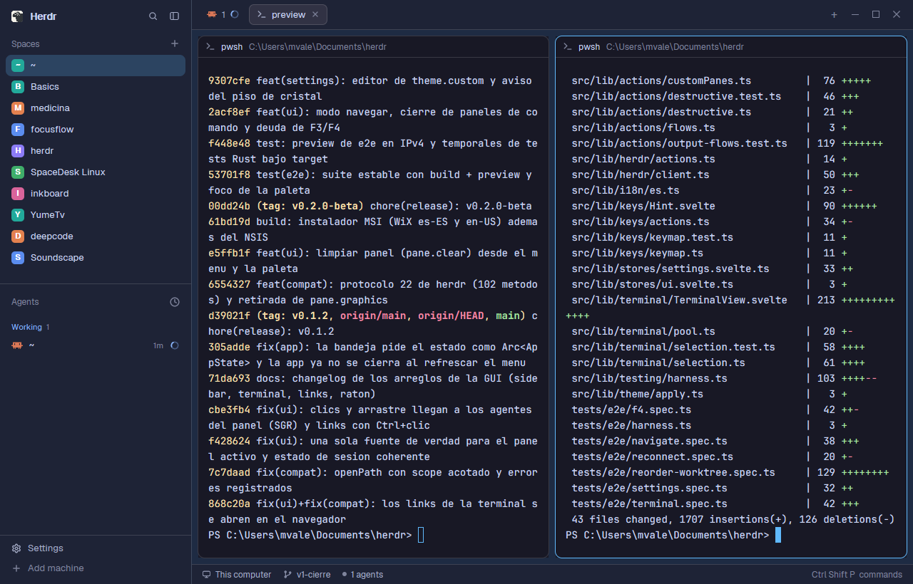

# Catppuccin

Herdr's own window (spaces and agents on the left, tabs as pills, panes as cards, a status bar) in the Catppuccin palette used by **herdr-desk**, the Tauri GUI for herdr, with a sky-blue `#60b9fc` accent. Catppuccin Mocha in dark mode, Latte in light mode; it follows the system appearance by itself.



## What's inside

| File | What it is |
|---|---|
| `layouts/catppuccin.json` | the layout (Herdr's main window structure) |
| `layouts/catppuccin.png` | the picture Settings shows for it |
| `themes/herdr-catppuccin.json` | Catppuccin Mocha, dark |
| `themes/herdr-catppuccin-latte.json` | Catppuccin Latte, light |

Only Herdr's shipped mods are used: no custom code, no programs run, no network access.

## Install

Copy the folders into your Herdr home (`~/.config/herdr-app`, or `HERDR_APP_HOME`), then switch to the layout:

```sh
git clone https://github.com/MarcozVD/herdr-layout-catppuccin
cp -r herdr-layout-catppuccin/{layouts,themes} ~/.config/herdr-app/
herdr-app do layout.switch '{"name":"catppuccin"}'
```

On Windows PowerShell:

```powershell
git clone https://github.com/MarcozVD/herdr-layout-catppuccin
Copy-Item -Recurse -Force herdr-layout-catppuccin/layouts,herdr-layout-catppuccin/themes "$HOME/.config/herdr-app/"
herdr-app do layout.switch '{"name":"catppuccin"}'
```

`ctrl-shift-l` cycles back to your other layouts. To remove it, delete the files listed above from `~/.config/herdr-app`.

Or ask your agent to add it: *"add the Herdr layout at github.com/MarcozVD/herdr-layout-catppuccin"*.

## Build it yourself

[`RECIPE.md`](RECIPE.md) is the full brief (regions, sizes, exact colors, node tree, gotchas, checks): an agent with an empty folder can rebuild the layout from it.

The themes also work on their own: set `"theme": { "light": "herdr-catppuccin-latte", "dark": "herdr-catppuccin" }` in `settings.json` to use them with any layout.

Palette: [Catppuccin](https://catppuccin.com) (MIT).

## Related

- [herdr-layout-catppuccin](https://github.com/MarcozVD/herdr-layout-catppuccin): Catppuccin Mocha / Latte, solid panels.
- [herdr-layout-onedark](https://github.com/MarcozVD/herdr-layout-onedark): One Dark / One Light, solid panels.
- [herdr-layout-glass](https://github.com/MarcozVD/herdr-layout-glass): glassmorphism in neutral graphite.
