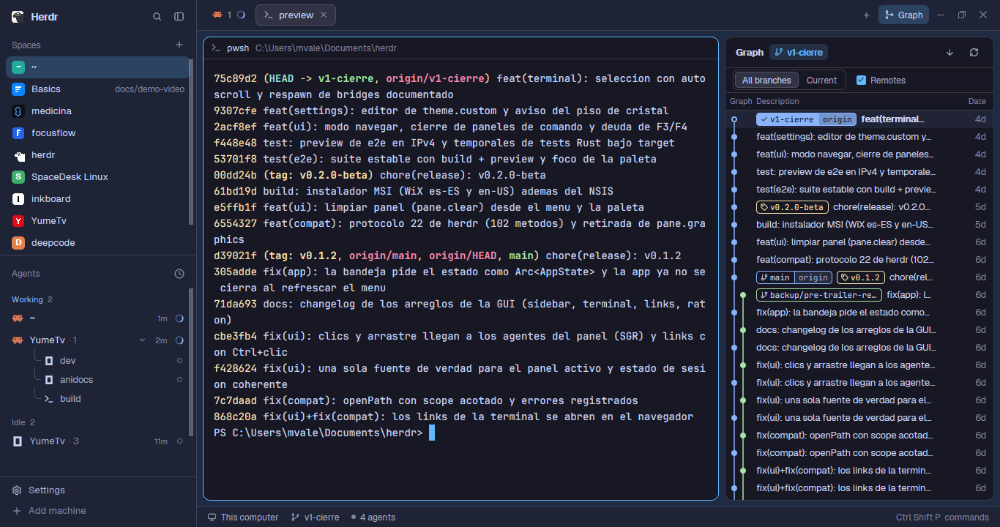

# Catppuccin

Herdr's own window (spaces and agents on the left, tabs as pills, panes as
cards, a status bar) dressed in the palette of **herdr-desk**, the Tauri GUI
for herdr: Catppuccin Mocha panels with a sky-blue `#60b9fc` accent in dark
mode, Catppuccin Latte with the same accent in light mode. It follows the
system's light/dark appearance by itself.

## What you see

Left to right, at zoom 1:

- **Sidebar**, 268px wide (44–480), on `chrome` (`#1e2336` dark,
  `#e4e7ef` light), no system title bar:
  - top 46px: the Herdr brand row with search and fold buttons (drags the window);
  - Spaces list and Agents list, sharing the height equally (each at least 90px);
  - bottom 69px: Settings and Add machine.
- A 1px `border` divider (`#ffffff24` dark, `#0000001f` light).
- **Work column** on `canvas` (`#1e2b43` dark, a navy tinted by the accent;
  `#d7dbf0` light):
  - top 42px: tabs as pills with a `+` menu and the window buttons (drags the window);
  - the active tab's panes as cards, 8px padding and 8px gaps, radius 10,
    on `background` (`#181825` dark, `#eff1f5` light), 1px `border`;
    the focused pane gets a 1px accent `#60b9fc` border. Each pane has a
    30px header on top (program icon, title, folder);
  - an optional Files/Changes panel on the right, 368px (280–900), hidden at start;
  - bottom 28px: status bar (machine, branch, agent count, palette hint).
- Terminals: Catppuccin text `#cdd6f4` on `#181825` (Latte `#4c4f69` on
  `#eff1f5`), cursor `#60b9fc`, selection `#45475a` (`#bcc0cc`), padding
  14px × 12px. Fonts are Herdr's defaults: JetBrains Mono 14 and Geist.

Other theme colors: `surface` `#1a1d2d`, `popover` `#20202e`, `raised`
`#313244`, `hover` `#cdd6f41a`, `selected` `#60b9fc38`, `input` `#ffffff33`,
`muted` `#a6adc8`, `dim` `#7f849c`; buttons are `#60b9fc` with `#14151c` text.
- **Project icons on the space avatars**: in the Spaces list, each space whose
  project has an icon shows it on its 18px avatar (radius 5), in full color.
  Spaces without one keep Herdr's colored letter tile.
- **Graph button** in the tab bar, right of `+`, when the git-graph mod
  (github.com/rabeeh-ta/herdr-git-graph) is installed: a 26px pill (radius 6,
  14px graph icon, "Graph" at 12px, `muted` on `chrome`, `selected` when its
  panel shows). It opens the side panel (368px) with Git Graph's commit graph of
  the focused terminal's repository. Without git-graph the button isn't drawn.

## How it behaves

- Agent status uses the theme's status colors in the shipped mods (sidebar
  agents list, tab pills, status bar): **working** `#89b4fa` (light
  `#1e66f5`), **blocked** `#f9e2af` (`#df8e1d`), **done** `#a6e3a1`
  (`#40a02b`), **idle** `#6c7086` (`#9ca0b0`), unknown `#cba6f7` (`#8839ef`).
- Everything else is Herdr (main): click a space or tab to show it, `+` starts
  a terminal or an agent, the tab bar opens Files/Changes, `ctrl-shift-b` folds
  the sidebar to a 44px rail, `ctrl-shift-l` cycles layouts, panes drag by the
  top-center grip.
- The theme follows the system appearance; Settings > Look can pick another
  theme for this layout.
- **Project icons**: for each space on this computer, the `spaces-icons` mod
  looks in its project folder (the git repo's top, else where its first terminal
  is, else where the space was made; never the home folder) for, in this order:
  `.herdr/icon.svg|png` (an override), Tauri icons
  (`src-tauri/icons/128x128@2x.png`, `128x128.png`, `icon.png`), `icon.*`,
  `logo.*`, `assets/`, `build/`, `resources/`, `src/app/`, `public/`,
  `src/assets/`, `.github/`, `docs/` logos and icons, then favicons
  (`public/favicon.svg`, ...). Each candidate is tried in the folder itself, its
  subfolders and `apps/*` / `packages/*`, so monorepos work. The first hit
  wins; PNGs under 16px wide are skipped as placeholders. The first search of
  all projects takes a few seconds, one project at a time. After that the
  results live in shared state: a layout or theme change starts a new copy of
  the mod, which inherits them and searches nothing. A project is looked at
  again only when it is new or its result is a day old.
- **Graph**: clicking the button selects `graph` in the side panel's stack and
  shows the panel; clicking it again while it shows hides the panel, like Files
  and Changes. Everything inside the panel is git-graph's own (lanes, labels,
  checkout on double-click, right-click menus, commit details).

## Built from

- `layouts/catppuccin.json`: a copy of the shipped `main` layout tree with two root
  additions: `"theme": { "light": "herdr-catppuccin-latte", "dark": "herdr-catppuccin" }`
  and `"preview": "layouts/catppuccin.png"`. Root: `row`, `titlebar: "none"`,
  `traffic_lights: [12, 16]`, `background: "canvas"`, `terminal_padding: [14, 12]`,
  divider 1px `border`.
  - `sidebar` (column, 268px, `chrome`, `resizable: false`): `brand` block
    (46px, `window_drag`, mod `workspace-chrome`), `sidebar-lists` column with
    `spaces` (mod `spaces-icons`) and `agents` blocks (weight 1, min 90), `sidebar-footer` block
    (69px, mod `workspace-chrome`, props `{ "footer": true }`).
  - `work` (column, `resizable: false`): `tabs` block (42px, `window_drag`, mod
    `tabs-graph`), `work-body` row (padding 8, gap 8) with `main` block
    (`{ "tab": "active" }`, pane frame: gap 8, radius 10, background
    `background`, `lone: true`, border 1 `border`, focus 1 `accent`, header mod
    `pane`, 30px, top, `reveal: "always"`) and a hidden `panel` column (368px)
    holding a `stack` of `files` and `changes` blocks; `status` block (28px, mod
    `workspace-status`).
- Mods: `spaces-icons` (below) for the Spaces list, `tabs-graph` (below) for
  the tab bar, and the shipped
  `workspace-chrome`, `agents`, `pane`, `files`, `changes`,
  `workspace-status`.
- `themes/herdr-catppuccin.json` and `themes/herdr-catppuccin-latte.json`, generated from
  herdr-desk's tokens (Catppuccin Mocha / Latte, as transcribed from herdr):
  - `background` = herdr `panel_bg`, `foreground` = `text`, `selection` =
    `surface1`, `cursor` = accent.
  - `ansi`: black `surface_dim`, red/green/yellow/blue/magenta(`mauve`)/cyan(`teal`)/white(`text`),
    bright black `overlay0`, other brights = color mixed 25% toward `text`.
  - `colors`: `canvas` = base `#0b1020` (light `#e7e7ef`) mixed 12% (10%)
    toward the accent and 5% (4%) toward mauve; `chrome` = canvas mixed 60%
    (85%) toward `surface_dim`; `surface` = canvas mixed 75% (90%) toward
    `panel_bg`; `hover` = text at 10%, `selected` = accent at 22%, `border`
    white at 14% (light: black at 12%), `input` white 20% (black 16%), `muted`
    = `subtext0`, `dim` = `overlay1`, status colors as above.
- `mods/spaces-icons/`: a clone of the shipped `spaces` mod
  (`herdr-app do mod.clone '{"name":"spaces","as":"spaces-icons"}'`), used by the
  `spaces` block instead of `spaces`. Its changes:
  - `icons.js`: `findIcon(root)` lists the folders once (`fs.readdir`), skips
    candidates whose first path part isn't there, checks the rest with
    `fs.exists`, reads a PNG's width from its header, and copies the hit into
    `data/spaces-icons/<hash of path>.<svg|png>` in the Herdr home, because
    `image()` only reads paths relative to the home. SVGs are copied as text
    (`fs.readFile` utf8 + `fs.writeFile`); PNGs with `exec("cmd", ["/c",
    "copy", "/y", src, dest])` on Windows, `exec("cp", [src, dest])` elsewhere.
  - `main.js`: `roots(space, panes)` gives the project folders.
    `init` loads `shared("spaces-icons.found")` (`{folder: {icon: path|null, at}}`).
    Every 8th 250ms `checkNew` tick (2s), `lookForIcons` queues only folders
    missing from it or older than 24h, searches the queue in one task, one
    folder at a time, and writes the map back with one `setShared` when done. `grouped` reads
    `panes()` once per render and passes each row its `icon`; `row` draws
    `div().size(18).rounded(5).overflow_hidden().child(image(icon).size(18))`,
    else the original letter tile. Everything else is the shipped `spaces`.
- `mods/tabs-graph/`: a clone of the shipped `tabs` mod
  (`herdr-app do mod.clone '{"name":"tabs","as":"tabs-graph"}'`), used by the
  `tabs` block, following git-graph's `docs/top-bar.md`. Its changes:
  - `init(_props, cx)` checks once, with `fs.exists`, for
    `<appHome>/mods/git-graph/main.js` and sets `this.hasGraph`.
  - The enabled panels become `[...(shared("workspace.panels") ?? ["files",
    "changes"]), ...(this.hasGraph ? ["graph"] : [])]`.
  - After the Changes button: `.when(enabled.includes("graph"), el =>
    el.child(panelButton("graph", "Graph", "mods/git-graph/icons/graph.svg")))`.
- The `panel-body` stack gets a third child after `files` and `changes`:
  `{ "id": "graph", "type": "block", "content": { "mod": "git-graph" } }`.
- `mods/git-graph/` itself isn't in this repo: install it from
  github.com/rabeeh-ta/herdr-git-graph (MIT). It runs `git` in the focused
  repository, reads the repositories open in other spaces ahead every 15s, and
  reaches the network only through git (Fetch, Push, deleting a remote branch).

## Watch out

- Without `mods/git-graph/` the Graph button is hidden but the `graph` block
  is still in the stack; nothing opens it, so it stays unseen.
- `tabs-graph` is a frozen copy of Herdr 0.1.10's `tabs`: a Herdr release that
  changes the tab bar won't reach it. Clone `tabs` again and redo the three edits.
- Each layout keeps its own panel state: opening Graph in one layout doesn't open
  it in another.

- `spaces-icons` reads files outside its own folder (the projects of your
  spaces) and runs a program to copy PNG icons (`cmd /c copy` on Windows,
  `cp` elsewhere). It writes only under `data/spaces-icons/` and the shared key
  `spaces-icons.found`. No network.
- `image("C:/abs/path.png")` draws nothing: icons must be copied into the home.
  `fs.writeFile` with the `Uint8Array` from `fs.readFile` wrote 0-byte files
  in this build, hence the system copy for PNGs.
- Reading `panes()` inside each row made the list too slow to render ("This view
  could not be re-rendered"); read it once per render.
- Spaces on other machines and the `~` space keep the letter tile. `.ico`
  favicons aren't used (GPUI doesn't draw them). A new or changed icon shows
  within a day (or delete `data/spaces-icons/` and the shared key to look again
  now).
- Don't search per mod copy: each layout switch and theme change starts the
  mods fresh, so a per-run search redid every project's disk scan on every
  switch. Searching in parallel and calling `setShared` per result also made
  every mod redraw once per project.
- Switching layouts in Herdr itself froze the window for up to ~5s in testing,
  with the shipped `main`/`terminals` layouts and with the shipped `spaces`
  mod too; it isn't this mod.
- The rail (sidebar narrower than 160px) shows numbers, as the shipped mod does,
  not icons.

- The theme files are named differently from the layout on purpose: a theme
  named like a layout (`themes/catppuccin.json`) would belong only to that layout,
  and these two are also meant for `settings.json`'s `theme`.
- The accent `#60b9fc` is the person's own `[theme.custom] accent`, not
  Catppuccin's `#89b4fa`. On the light theme it is low contrast as a text
  color; Herdr's mods use it for borders and fills, where it reads fine.
- A theme pick in Settings > Look is stored per layout in `layouts/.state/`
  and beats the layout file; if the colors don't change, pick this layout's themes
  there or run `herdr-app do app.theme '{"name":"herdr-catppuccin"}'`.
- `herdr-app shot` returns the last rendered frame: after a theme change,
  wait for the window to redraw before trusting a screenshot.

## Done when

- `herdr-app do layout.switch '{"name":"catppuccin"}'` shows the layout and
  `herdr-app status` lists no errors.
- With a dark system appearance, the sidebar pixel reads `#1e2336`, an empty
  terminal reads `#181825` and the focused pane's border is `#60b9fc`.
- In light appearance the terminal reads `#eff1f5` with `#4c4f69` text.
- `themes()` from a mod lists `herdr-catppuccin` (`light: false`) and
  `herdr-catppuccin-latte` (`light: true`) with those colors.
- `herdr-app check mods/spaces-icons` passes.
- A space whose repo has `src-tauri/icons/128x128.png` shows that picture on its
  avatar within about 10 seconds, and `data/spaces-icons/` holds a non-empty copy;
  a space with no icon file shows its colored letter.
- `herdr-app check mods/tabs-graph` passes. With git-graph installed, Graph
  shows in the tab bar and opens a commit graph of the focused terminal's repo
  (`Not a git repository` outside one); with it removed, the button is gone.
